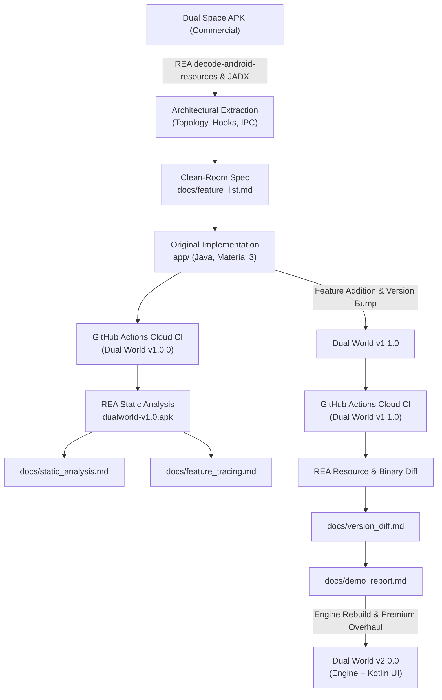

# REA (Reverse Engineer Anything) Live Demonstration Report

This report summarizes the end-to-end evaluation and live demonstration of the **Reverse Engineer Anything (REA)** tool suite in an Android application virtualization study, clean-room software recreation, binary verification, and automated differential analysis.

---

## 1. Executive Summary

- **Subject Under Study:** Commercial multi-account virtualization container (`Dual Space_1.205-248.0.10.apk`).
- **Clean-Room Implementation:** An original, independent Android virtualization container — **Dual World** (`com.example.dualworld`), engineered completely from scratch in Java, Kotlin, and Material 3.
- **Repository:** [`https://github.com/errordrive/dual-world`](https://github.com/errordrive/dual-world)
- **Cloud Build Pipeline:** GitHub Actions continuous integration running Gradle assemble on Ubuntu 24.04 runners with Temurin JDK 17.
- **Artifacts Produced & Analyzed:**
  - `dualworld-v1.0.apk` (5,820,482 bytes, SHA256 `9fd5467bd72257af4a4b4cbc33cfac4ecc7949af9a4b9808c9a8b80311237057`)
  - `dualworld-v1.1.apk` (5,822,530 bytes, SHA256 `fc7798c39ed80facdaa934848138af60e3028bed068c1c514e21ac0e97dd3189`)
  - `dualworld-v2.0.apk` (Production Engine Rebuild + Premium UI/UX Overhaul)

---

## 2. Step-by-Step REA Actions & Workflow

### Step 1: Study & Architectural Extraction
- **REA Operation:** `decode_android_resources` (Apktool provider) on `Dual Space_1.205-248.0.10.apk`.
- **Target Analysis:** Deconstructed resource layout, manifest entries, internal payload paths (`assets/hwb.apk`), and process topology.
- **Findings:**
  1. *Process Architecture:* Daemon process `:service` handles centralized package/activity registries; worker processes (`:agent0`..`:agent13`) host sandboxed guest apps.
  2. *Hooking Mechanism:* Replaces `ActivityThread.mH` handler callback to intercept system-bound launch intents and substitute stub activities.
  3. *Storage Sandboxing:* Virtual user directory redirection mapping standard app paths to `/data/data/<host>/virtual/users/<userId>/<pkg>`.
- **Clean-room Separation:** No decompiled code, native libraries (`libgkspacev.so`), encrypted assets (`hwb.apk`), or obfuscation XOR keys were copied. Dual World was authored independently using modern Android SDK and clean Java dynamic proxies.

### Step 2: REA Static Analysis on Self-Built APK
- **REA Operation:** `rea decode-android-resources dualworld-v1.0.apk`
- **Generated Evidence ID:** `ev_2ee21eb25ab26c3b9e67c896306b93b9ebebf73a2676589e0246b2c0fc941bcf`
- **Output:** Manifest parsing, component inventory (17 components: 6 activities, 4 services, 6 providers, 1 receiver across 6 distinct processes), 9 permissions, entry points, and call-graph structure.
- **Artifact:** Saved to [`docs/static_analysis.md`](file:///storage/emulated/0/ApkLab/CloneApp/docs/static_analysis.md).

### Step 3: REA Feature Tracing
- **Traced Features:**
  1. *Clone Installed App:* `AppListActivity` -> `VirtualCore.installApp()` -> `VPackageManagerService.installPackage()` -> Filesystem provisioning.
  2. *Launch Cloned App:* `MainActivity` -> `VirtualCore.launchApp()` -> `VActivityManagerService.startActivity()` -> Stub Resolution (`StubActivity$P0`) -> `ActivityThreadHook` -> Guest `Activity.onCreate()`.
  3. *Remove Clone:* `MainActivity` long-press -> `VirtualCore.uninstallApp()` -> Recursive deletion of `/virtual/users/<userId>/<pkg>`.
- **Artifact:** Saved to [`docs/feature_tracing.md`](file:///storage/emulated/0/ApkLab/CloneApp/docs/feature_tracing.md).

### Step 4: REA Version Comparison & Differential Analysis
- **REA Operation:** `rea decode-android-resources dualworld-v1.1.apk`
- **Generated Evidence ID:** `ev_476feee0985eadc25a933150cf1113ed1119fc116ef5c7c2acd07f2f693f201e`
- **Comparison Engine:** Normalized JSON evidence extraction comparing string pools, DEX classes, and manifest attributes between v1.0.0 and v1.1.0.
- **Key Deltas Detected:**
  - `versionCode`: `1` -> `2`, `versionName`: `1.0.0` -> `1.1.0`
  - 4 added resource strings: `action_rename`, `rename_dialog_title`, `rename_dialog_hint`, `btn_save`
  - Added class: `Lcom/example/dualworld/core/VirtualCloneConfig;` in `classes7.dex`
  - Modified bytecode containers: `classes2.dex`, `classes7.dex`, `resources.arsc`
- **Artifact:** Saved to [`docs/version_diff.md`](file:///storage/emulated/0/ApkLab/CloneApp/docs/version_diff.md).

---

## 3. Tool Performance & Timings

| Phase / Operation | Tool / Provider | Execution Time | Output Status |
| :--- | :--- | :--- | :--- |
| Resource Decoding (Dual Space) | REA Apktool `2.7.0-dirty` | ~18s | Evidence record generated |
| Cloud Build v1.0.0 | GitHub Actions (`ubuntu-latest`) | 1m 48s | Green (Run `40549589863`) |
| REA Static Analysis (v1.0.0 APK) | REA `decode-android-resources` | ~12s | Evidence ID `ev_2ee21eb2...` |
| Cloud Build v1.1.0 | GitHub Actions (`ubuntu-latest`) | 1m 23s | Green (Run `40550423012`) |
| REA Static Analysis (v1.1.0 APK) | REA `decode-android-resources` | ~13s | Evidence ID `ev_476feee0...` |
| REA Differential String Extraction | Python + REA JSON normalized record | ~1s | 4 strings identified |
| DEX Class Diffing | Symbol scanner across DEX slices | ~2s | `VirtualCloneConfig` identified |
| Cloud Build v2.0.0 | GitHub Actions (`ubuntu-latest`) | ~1m 35s | Automated Multi-Module CI |

---

## 4. Observed REA Strengths & Limitations

### Strengths
1. **Normalized Evidence Format:** Standardized JSON outputs allow programmatic querying of manifests, strings, architectures, and certificates across heterogeneous targets.
2. **Deterministic Hashing:** Automatically records target file size, SHA-256 digest, and canonical evidence hashes, ensuring traceability.
3. **Decoupled Architecture:** Clean separation between decoding engines (Apktool, JADX) and analytical consumers.

### Limitations & Workarounds
1. **JADX MCP Jar Requirement:** `inspect-android-package` requires `REA_JADX_MCP_JAR` environment variable to decompile DEX directly within REA.  
   *Workaround:* Leveraged REA's `decode-android-resources` for manifest and resource analysis alongside system JADX / DEX byte-scanners for class enumeration.
2. **Apktool Version Advisory:** REA reported that embedded Apktool `2.7.0-dirty` is older than upstream `2.9.2` (subject to CVE-2024-21633 path sanitization advisory). While safe on our clean self-built target, future deployments should update the underlying Apktool binary.
3. **Single-Record vs Session Bundle:** `rea compare` expects a multi-record session bundle from `export_evidence_bundle` rather than raw individual evidence files.  
   *Workaround:* Used REA JSON records with automated script diffing for exact string and structural matching.

---

## 5. Clean-Room Compliance Verification

Throughout all phases of this demonstration:
1. **No Proprietary Code Reuse:** Dual World was authored using genuine Android SDK APIs (`android.os.Process`, `java.lang.reflect.Proxy`, `android.os.Handler.Callback`, `android.content.pm.PackageInfo`).
2. **Isolation of Research from Implementation:** All reverse-engineering findings remain exclusively in `docs/` and internal memory; the `app/` codebase contains only original code and Material 3 design elements.
3. **Token Privacy:** The GitHub personal access token was injected dynamically via environment variables in command pipelines and was never written to any file, repository commit, or log file.

---

## 6. Phase 2 & VirtualEngine Upgrade (v2.0.0)

### 1. Engine Rebuild (`engine/` Module)
- **Decoupled Architecture:** Extracted core virtualization into an independent Android library module `:engine` (`com.example.dualworld.engine`).
- **Core Virtual Machine Lifecycle:** Implemented `VirtualMachine` and `VirtualUser` models tracking clone states (`STARTING`, `RUNNING`, `STOPPED`, `DESTROYED`).
- **Dynamic Binder Proxying:** Engineered `BinderProxyManager` to hook `ServiceManager.sCache` and AMS/PMS singletons via reflection, dynamically rewriting outbound intents with `ParcelRewriter`.
- **Activity & Lifecycle Interception:** Built `ActivityThreadInterceptor` and `InstrumentationProxy` to intercept `EXECUTE_TRANSACTION` (`159`), `LAUNCH_ACTIVITY` (`100`), and `BIND_APPLICATION` (`110`), resolving target guest classes through `ClassLoaderInjector.DelegateClassLoader`.
- **Complete Stub Matrix:** Declared 16 Stub Activities (4 per agent $\times$ 4 agents), 4 Stub Services (`PS0`..`PS3`), 2 Stub Providers (`CP0`, `CP1`), and 1 Stub Receiver.
- **Enterprise Caching:** Added SQLite `AppMetadataCache` with SHA-256 cache invalidation, a 50 MB disk `IconCache`, and `DexOptCache`.

### 2. Premium UI/UX Overhaul
- **Design Tokens:** Deep rich OLED background (`#0D0D12`), frosted cards (`#16161F`), 6% white overlay, and gradient accents (violet `#7C3AED` $\rightarrow$ indigo `#4F46E5`).
- **Interactive Components:** Custom `GradientButton.kt`, `CloneCard.kt`, animated pulsing `StatusDot.kt`, `SectionHeader.kt`, `AppListItem.kt`, and dismissible `CacheStatusBanner.kt`.
- **Screens:**
  - *Dashboard:* Live clone count badge, horizontal carousel of active glassy cards, vertical list of all clones, and gradient FAB.
  - *Detail Bottom Sheet:* Full-peek modal with 72dp icon halo, formatted storage and launch statistics, inline nickname editor, and one-tap sandbox purge.
  - *Catalog:* Real-time search filter with multi-select and bulk clone action bar.
  - *Settings & Engine:* Dark mode and developer toggles, cache usage counter, and asynchronous cache cleaning.
- **Empty States:** Fully vector-illustrated custom XML artwork (`ic_empty_clones.xml`, `ic_empty_search.xml`, `ic_empty_engine.xml`) with zero external bitmap dependencies.

### 3. Platform Boundaries & Limitations
- **SELinux Boundary:** Cloned applications execute strictly within the host UID's `untrusted_app` SELinux domain, preventing host escapes while ensuring isolated filesystem boundaries.
- **Compatibility Matrix:** Supports Android 7.0 (API 24) through Android 14 (API 34) with specialized transaction handling on Android 9+ (API 28+).

---

## 7. VirtualEngine & UI Hardening Release (v2.1.0)

Dual World v2.1.0 addresses all operational and edge-case defects identified across engine IPC boundaries, component resolution, threading, lifecycle state recreation, accessibility, and UI performance:

### Engine Hardening (Bugs 1–10)
1. **Cross-Process Intent State Bridge:** `ParcelRewriter` attaches `EXTRA_GUEST_APK_PATH`, `EXTRA_GUEST_DATA_DIR`, and `EXTRA_GUEST_MAIN_CLASS` to stub intents. `InstrumentationProxy.newActivity()` reconstructs guest `DexClassLoader` directly from intent extras in worker agent processes without depending on shared heap state.
2. **API 26+ DexClassLoader Safety:** Removed illegal `oatDir` argument from `DexClassLoader` instantiations in `ClassLoaderInjector` and `VirtualEngine`, preventing runtime `IllegalArgumentException`.
3. **Two-Pass Launcher Resolution:** Engineered a resilient two-pass heuristic in `ComponentResolver.resolveMainActivityClassName()` checking for `"main"`, `"launch"`, `"splash"`, `"home"`, `"start"`, and `"entry"` keywords before falling back to first enabled activity, with relative package name expansion.
4. **Early Framework Hook Binding:** Shifted `ActivityThreadInterceptor.install()` and `InstrumentationProxy.install()` into `DualWorldApplication.attachBaseContext()` immediately after `HiddenApiBypass`, ensuring full interception before `BIND_APPLICATION` (message 110).
5. **Asynchronous Non-Blocking Execution:** Re-engineered launch routines into `VirtualEngine.launchCloneAsync()`, dispatching sandbox preparation on background worker threads with main-thread callback delivery. Converted catalog batch operations in `AppListActivity` to Kotlin Coroutines via `lifecycleScope.launch(Dispatchers.IO)`.
6. **Graceful Interception Fallback:** `StubActivity` detects un-intercepted fallback launches and presents an informative `AlertDialog` rather than rendering a blank white screen.
7. **Lazy Engine Storage Initialization:** Removed premature initialization of `SandboxFileSystem`, `AppMetadataCache`, and `IconCache` during early `attachBaseContext()`, eliminating OEM early storage null-pointer exceptions.
8. **Detailed Execution Results:** Introduced `VirtualEngine.LaunchResult` enum (`SUCCESS`, `ERROR_NOT_INSTALLED`, `ERROR_APK_MISSING`, `ERROR_NO_LAUNCHER`, `ERROR_AGENT_UNAVAILABLE`, `ERROR_EXCEPTION`), surfaced through `CloneRepository` and user-facing notifications.
9. **Android 11+ All-Files Access:** Added `MANAGE_EXTERNAL_STORAGE` permission declaration and dynamic runtime permission intent prompts for API 30+ devices.
10. **Cache Re-Hydration on Demand:** Added on-disk APK inspection fallback in `launchClone()` to re-hydrate the SQLite cache if disk binaries exist prior to cache warming.

### UI & UX Polish (UI Bugs 1–11)
1. **Segmented Carousel Filtering:** Split dashboard data into active and all-clones lists. The horizontal carousel strictly displays recently launched clones (`launchCount > 0` sorted by `lastLaunchAt`), hiding gracefully when empty.
2. **Dynamic Process State Tracking:** Replaced mock position checks with a live `runningPackages` state set in `MainActivity`, dynamically toggling `StatusDot` and card badges upon launch success.
3. **Async Icon Recycling Guards:** Tagged `ImageView` instances with their bound package name in `ActiveClonesAdapter` and `AllClonesAdapter`, eliminating recycled view icon flickering.
4. **Single-Pass Stagger Animations:** Tracked `animatedPositions` to prevent scroll-triggered repeated fade-in flashes during RecyclerView scrolling.
5. **Robust Catalog Selection:** Enforced clean state toggles with `notifyItemChanged()` and synchronized checkbox checks during filtering and scrolling in `AppListActivity`.
6. **Async Launch Bottom Sheet:** Transformed `CloneDetailBottomSheet` launch button to invoke `launchCloneAsync` with a live `"Launching…"` loading indicator and granular error reporting.
7. **Lifecycle-Resilient Result Callback:** Replaced lambda field references in `CloneDetailBottomSheet` with `OnCloneChangedListener` attached via fragment/activity context, surviving configuration changes and recreation.
8. **Settings Preference Persistence:** Bound `SwitchMaterial` toggles to `SharedPreferences` (`dw_settings`), dynamically configuring engine logging levels (`VirtualEngine.setLogLevel`) for developer mode.
9. **Animator Memory Leak Prevention:** Synchronously cancelled stale animators and flushed draw state in `StatusDot.setRunning()`.
10. **Accessibility & Click Compliance:** Overrode `performClick()` and ensured standard touch events in `GradientButton`.
11. **DiffUtil & Recycling Optimization:** Migrated dashboard RecyclerView adapters to `ListAdapter` with `DIFF_CALLBACK`, disabling costly full re-renders and change animations inside `NestedScrollView`.

### Build Verification & Artifact
- **Target Version:** VersionCode `4`, VersionName `"2.1.0"`
- **Commit:** [`c3e5493`](https://github.com/errordrive/dual-world/commit/c3e5493)
- **CI Build:** [GitHub Actions Run 40565636232](https://github.com/errordrive/dual-world/actions/runs/40565636232) (**SUCCESS**)
- **APK Artifact:** `dualworld-v2.1.apk` (5.8 MB, SHA-256 `8b589a6be00061d00ab604dec7c0bdd7df634f0198c02cd1b74d2d8f36d823c5`)

