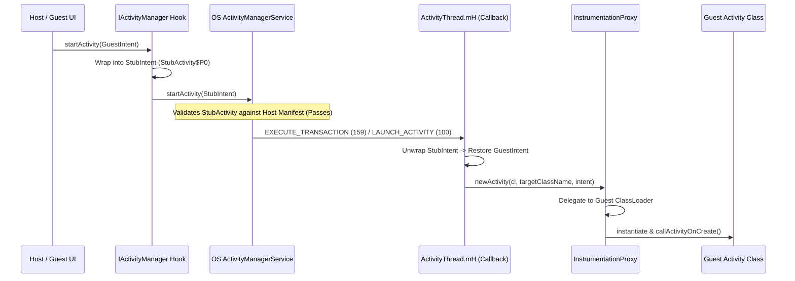

# Dual World Engine Design: Clean-Room Architectural Specification

This document synthesizes core design principles studied from open-source Android virtualization frameworks (**VirtualApp**, **DroidPlugin**, and **VirtualXposed**) to establish a clean-room specification for the new `engine/` module (`com.example.dualworld.engine`).

---

## 1. Process Topology

To provide complete isolation between the host UI, central orchestration state, and multiple guest applications, the runtime is partitioned into 3 distinct process categories:

```
┌────────────────────────────────────────────────────────┐
│ Main Process (com.example.dualworld)                   │
│ • Premium UI Dashboard, Settings, App Catalog          │
│ • Room / SQLite Metadata Cache & Icon Decoder          │
└──────────────────────────┬─────────────────────────────┘
                           │ IPC via ContentProvider / Binder
┌──────────────────────────▼─────────────────────────────┐
│ Server Daemon (:service)                               │
│ • VActivityManagerService (task & process pool state)  │
│ • VPackageManagerService (guest manifest parser cache) │
│ • StubCoordinator (stub allocation & token tracking)  │
└──────────────────────────┬─────────────────────────────┘
                           │ IPC via ContentProvider / Binder
┌──────────────────────────▼─────────────────────────────┐
│ Agent Worker Pool (:agent0 .. :agent3)                 │
│ • Isolated Linux UID sub-processes                     │
│ • Dedicated DelegateClassLoader per active clone       │
│ • Hooked Binder proxies & ActivityThread interceptor   │
│ • Sandbox FileSystem path translation                  │
└────────────────────────────────────────────────────────┘
```

1. **Main Process (`com.example.dualworld`):**  
   Hosts the user-facing application, catalog browser, icon rendering, settings, and database management. No guest code or DEX ever executes in this process.
2. **Server Daemon Process (`:service`):**  
   Acts as the central system daemon for virtualized components. Houses the registries for installed clones, running tasks, process leases, and stub token mappings.
3. **Agent Worker Pool (`:agent0` .. `:agent3`):**  
   Worker processes declared in `AndroidManifest.xml` that run the guest code. Each agent process hosts a guest runtime environment with its own classloader, hooks, and redirected storage paths.

---

## 2. Binder Proxy Injection Strategy

Android applications communicate with framework services (`activity`, `package`, `activity_task`) through Binder tokens managed by `android.os.ServiceManager`. To intercept IPC without modifying framework ROMs:

1. **`ServiceManager.sCache` Interception:**  
   Reflectively access `ServiceManager.sCache` (`Map<String, IBinder>`). When a system service like `"package"` or `"activity"` is queried, the cached `IBinder` is replaced with a Dynamic Proxy that wraps the real system Binder.
2. **Singleton Proxy Replacement:**  
   - On Android 8.0+: `ActivityManager.IActivityManagerSingleton` (`android.util.Singleton.mInstance`).
   - On Android 10+: `ActivityTaskManager.IActivityTaskManagerSingleton`.
   - On `ActivityThread.sPackageManager`.
3. **Invocation Handler Delegation:**  
   Every method call (`startActivity`, `getPackageInfo`, `getApplicationInfo`, etc.) is intercepted:
   - Client calls targeting guest components are translated into host stub components before crossing the Binder boundary into the OS kernel.
   - Return values (e.g. `ApplicationInfo.dataDir`, `packageName`) are spoofed to reflect the guest sandbox identity.

---

## 3. `ActivityThread.mH` & `Instrumentation` Interception

Android enforces strict component registration checks inside `ActivityManagerService` (AMS). Because guest components are not in the host's compiled manifest, AMS would throw an `ActivityNotFoundException`. The dual-stage interception model resolves this:



1. **Outbound Phase (Binder Hook):**  
   `startActivity` intercepts the guest `Intent`, puts it in the extras (`_v_target_intent_`), and replaces the component with an assigned `StubActivity` pre-declared in the manifest.
2. **Inbound Phase (`ActivityThread.mH` Callback):**  
   The `Handler.Callback` on `ActivityThread.mH` intercepts message `100` (`LAUNCH_ACTIVITY`) on Android 7-8 and message `159` (`EXECUTE_TRANSACTION`) on Android 9+. It unpacks the `ClientTransaction` `LaunchActivityItem`, extracts the real guest intent, and rewrites the target class name.
3. **Instantiation Phase (`InstrumentationProxy`):**  
   A custom `Instrumentation` wrapper replaces `ActivityThread.mInstrumentation`. In `newActivity(ClassLoader cl, String className, Intent intent)`, if the class name belongs to a guest app, the `DelegateClassLoader` loads the class from the sandbox APK and returns the initialized guest instance.

---

## 4. Package & Component Resolution for Guest Apps

Guest apps have their own `AndroidManifest.xml` defining activities, services, broadcast receivers, and providers:
- **`GuestPackageManager`**: Direct, non-root parser that extracts `PackageInfo`, `ActivityInfo`, `ServiceInfo`, and `ProviderInfo` from the guest APK file on disk using Android's internal `PackageParser` (via reflection) or fallback zip/AXML decoding.
- **`ComponentResolver`**: Matches explicit and implicit intents (actions, categories, data schemes) against the parsed guest manifest to identify the target component.
- **`PermissionMirror`**: Checks whether requested guest permissions are held by the host container; returns granted status to prevent permission crashes.

---

## 5. Per-Clone Filesystem Sandbox Layout

Each clone instance (identified by package name and integer `userId`) receives an isolated directory tree on internal storage:

```
/data/data/com.example.dualworld/virtual/
  ├── users/
  │    ├── 0/
  │    │   └── com.foo.guest/
  │    │        ├── cache/
  │    │        ├── code_cache/
  │    │        ├── databases/
  │    │        ├── files/
  │    │        └── shared_prefs/
  │    └── 1/
  │        └── com.foo.guest/ ... (Isolated Clone #2)
  ├── app/
  │    └── com.foo.guest/
  │         ├── base.apk
  │         ├── lib/
  │         │    └── arm64-v8a/
  │         │         └── *.so
  │         └── oat/
  │              └── arm64/
  └── cache/
       ├── icons/ (LRU disk cache)
       └── metadata/
```

- **`SandboxFileSystem`**: Overrides system-level path queries, redirecting `/data/user/0/<pkg>` and `/data/data/<pkg>` to the corresponding virtual user path.
- **`ApkInstaller`**: Extracts the APK into `/virtual/app/<pkg>/base.apk` and unzips compatible native shared libraries (`.so`) into `/virtual/app/<pkg>/lib/<abi>/`.

---

## 6. ClassLoader Chain Construction

To resolve guest classes without polluting the host class loader or colliding with other clones:

```
           BootClassLoader (System runtime classes)
                      ▲
                      │
           PathClassLoader (Host Dual World classes)
                      ▲
                      │
┌─────────────────────┴─────────────────────────────────────┐
│ DelegateClassLoader                                       │
│ • Parent: PathClassLoader                                 │
│ • DexPath: /data/data/.../virtual/app/<pkg>/base.apk      │
│ • OptimizedDir: /data/data/.../virtual/app/<pkg>/oat/     │
│ • NativeLibPath: /data/data/.../virtual/app/<pkg>/lib/    │
└───────────────────────────────────────────────────────────┘
```

1. A `DexClassLoader` is instantiated pointing to the guest APK, the isolated native library path, and a private oat directory.
2. The `DelegateClassLoader` intercepts `loadClass(name)`:
   - If the class starts with `com.example.dualworld.`, delegation passes to `PathClassLoader`.
   - Otherwise, the guest `DexClassLoader` resolves the class and its dependencies.
3. The delegate is injected into the guest `LoadedApk.mClassLoader` field to ensure all framework callbacks resolve guest types automatically.
