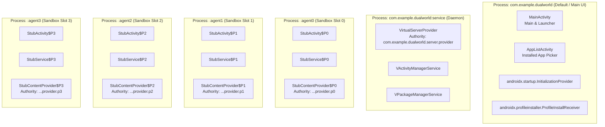
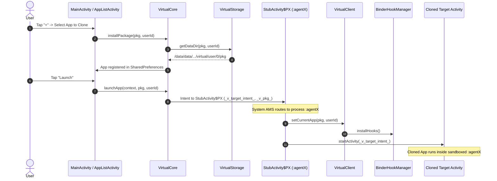

# REA Static Analysis Report: Dual World v1.0.0

**Target APK:** `dualworld-v1.0.apk`  
**Evidence ID:** `ev_2ee21eb25ab26c3b9e67c896306b93b9ebebf73a2676589e0246b2c0fc941bcf`  
**Package:** `com.example.dualworld`  
**Digest (SHA-256):** `9fd5467bd72257af4a4b4cbc33cfac4ecc7949af9a4b9808c9a8b80311237057`  
**File Size:** 5,820,482 bytes (~5.55 MB)  
**Min SDK:** 24 (Android 7.0) | **Target SDK:** 34 (Android 14)  
**Provider Tool:** `rea decode-android-resources` via Apktool 2.7.0  

---

## 1. Manifest & Package Overview

The application manifest defines a clean multi-process virtual container architecture:

```xml
<manifest package="com.example.dualworld" 
          android:versionCode="1" 
          android:versionName="1.0.0"
          compileSdkVersion="34" 
          platformBuildVersionCode="34">
```

### Declared Permissions
- `android.permission.INTERNET`
- `android.permission.ACCESS_NETWORK_STATE`
- `android.permission.ACCESS_WIFI_STATE`
- `android.permission.QUERY_ALL_PACKAGES` (Required for scanning installed apps to clone)
- `android.permission.REQUEST_INSTALL_PACKAGES`
- `android.permission.POST_NOTIFICATIONS`
- `android.permission.READ_EXTERNAL_STORAGE` (maxSdkVersion=32)
- `android.permission.WRITE_EXTERNAL_STORAGE` (maxSdkVersion=29)
- `com.example.dualworld.DYNAMIC_RECEIVER_NOT_EXPORTED_PERMISSION` (Signature)

---

## 2. Process Layout & Component Inventory

Dual World isolates components across 6 distinct processes:



### Component Breakdown
- **Activities (6 Total)**:
  - `com.example.dualworld.ui.MainActivity` (Process: Default, Exported: True, LaunchMode: singleTop)
  - `com.example.dualworld.ui.AppListActivity` (Process: Default, Exported: False)
  - `com.example.dualworld.stub.StubActivity$P0` (Process: `:agent0`, Exported: False)
  - `com.example.dualworld.stub.StubActivity$P1` (Process: `:agent1`, Exported: False)
  - `com.example.dualworld.stub.StubActivity$P2` (Process: `:agent2`, Exported: False)
  - `com.example.dualworld.stub.StubActivity$P3` (Process: `:agent3`, Exported: False)

- **Services (4 Total)**:
  - `com.example.dualworld.stub.StubService$P0` (Process: `:agent0`)
  - `com.example.dualworld.stub.StubService$P1` (Process: `:agent1`)
  - `com.example.dualworld.stub.StubService$P2` (Process: `:agent2`)
  - `com.example.dualworld.stub.StubService$P3` (Process: `:agent3`)

- **ContentProviders (6 Total)**:
  - `com.example.dualworld.server.VirtualServerProvider` (Process: `:service`, Authority: `com.example.dualworld.server.provider`)
  - `com.example.dualworld.stub.StubContentProvider$P0` (Process: `:agent0`, Authority: `com.example.dualworld.stub.provider.p0`)
  - `com.example.dualworld.stub.StubContentProvider$P1` (Process: `:agent1`, Authority: `com.example.dualworld.stub.provider.p1`)
  - `com.example.dualworld.stub.StubContentProvider$P2` (Process: `:agent2`, Authority: `com.example.dualworld.stub.provider.p2`)
  - `com.example.dualworld.stub.StubContentProvider$P3` (Process: `:agent3`, Authority: `com.example.dualworld.stub.provider.p3`)
  - `androidx.startup.InitializationProvider` (Process: Default)

- **BroadcastReceivers (1 Total)**:
  - `androidx.profileinstaller.ProfileInstallReceiver` (Process: Default)

---

## 3. Native Libraries & Execution Mode

- **Native Libraries**: None embedded (`extractNativeLibs="false"`).
- **Execution Mechanism**: Pure user-space reflection and dynamic proxying.
  - `BinderHookManager` replaces singletons in `android.app.ActivityManager` / `ActivityTaskManager` and `android.app.ActivityThread.sPackageManager`.
  - `ActivityThreadHook` installs a custom `Handler.Callback` inside `ActivityThread.mH`.

---

## 4. Call-Graph Sketch: Clone & Launch Execution Flow


